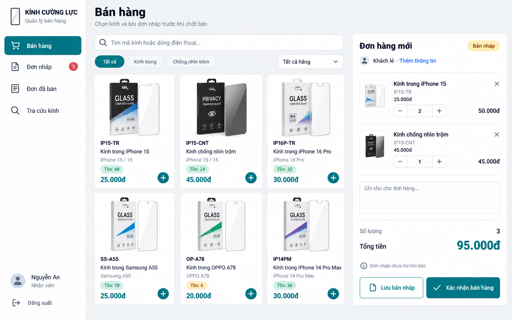
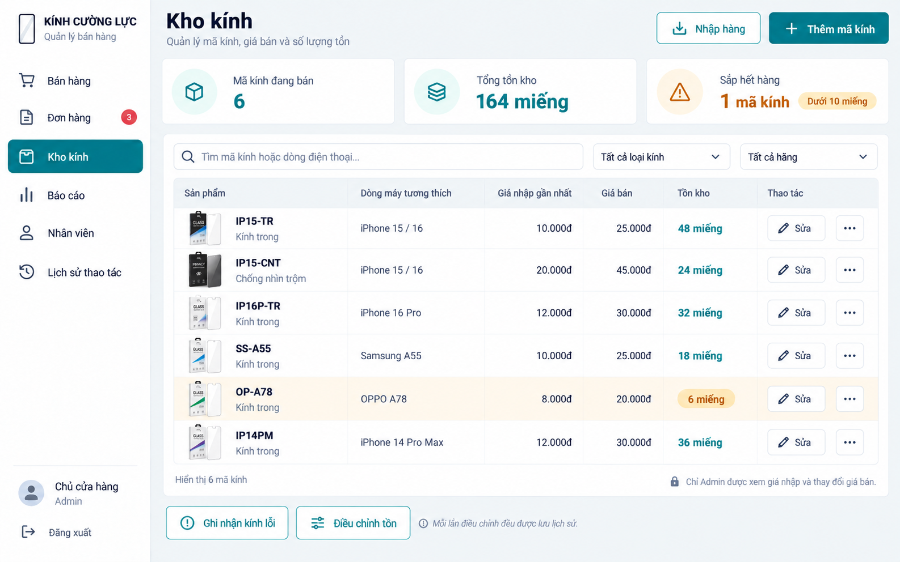
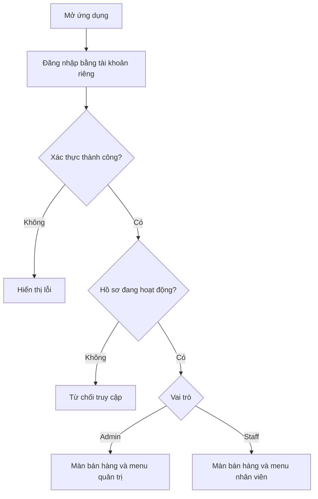
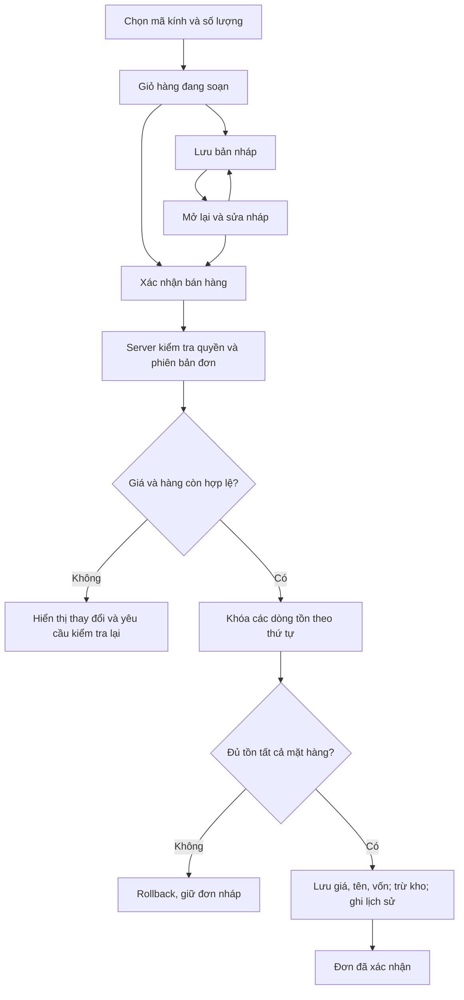
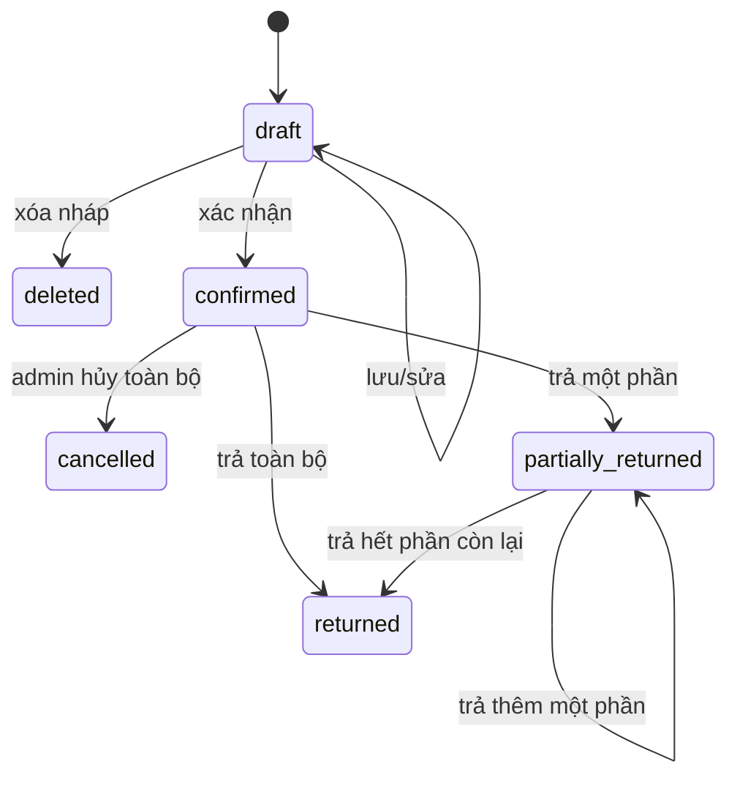
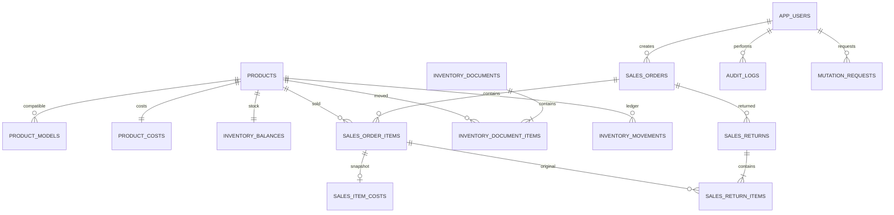
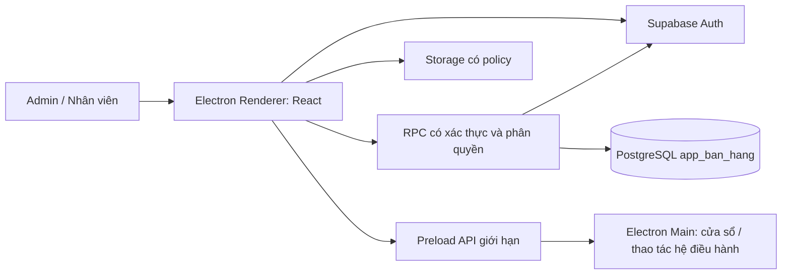

# ĐẶC TẢ ỨNG DỤNG DESKTOP QUẢN LÝ KHO VÀ BÁN KÍNH CƯỜNG LỰC

| Thuộc tính | Nội dung |
|---|---|
| Phiên bản | 1.3 — bổ sung hãng kính |
| Ngày cập nhật | 17/09/2026 |
| Workspace | `E:\AppBanHang` |
| Tài liệu gốc triển khai | `BA-SPEC.md` — đọc và cập nhật tài liệu này trước khi thay đổi phạm vi |
| Trạng thái | Đã có mã nguồn Electron/React; schema/RPC/bucket `app_ban_hang`, Auth, phiên đơn và quản lý nhân viên đã chạy trên Supabase. Còn nghiệm thu dữ liệu thật, backup/restore, ký số và máy khách đích. |
| Công nghệ đã chốt | Electron; kiến trúc chi tiết đề xuất tại mục 11 |
| Người sử dụng | Chủ cửa hàng/Admin và nhân viên bán hàng |
| Quy mô dự kiến | Một cửa hàng, một kho; một admin và hai nhân viên, mỗi người một tài khoản |
| Thiết kế giao diện | Dựa trên hai ảnh mockup tại mục 3 |

> Mục tiêu: công cụ dễ dùng, tập trung tra cứu kính, bán hàng bằng đơn nháp, nhập/xuất kho và theo dõi doanh thu/lãi gộp. Người dùng đã yêu cầu triển khai. Quy tắc nghiệp vụ dưới đây vẫn là baseline; trạng thái thực tế và những phần chưa nghiệm thu được ghi tại mục 19 và README.md.

## 1. Quyết định và phạm vi

### 1.1. Quy tắc đã được khách hàng/người dùng xác nhận

| ID | Nội dung bắt buộc |
|---|---|
| D01 | Sản phẩm kinh doanh là kính cường lực. |
| D02 | Ứng dụng desktop dùng Electron. |
| D03 | Hai vai trò: `admin` toàn quyền nghiệp vụ và `staff` nhân viên. Hai nhân viên không phải hai vai trò khác nhau. |
| D04 | Nhân viên không được xem giá gốc/giá vốn hoặc lợi nhuận. |
| D05 | Nhân viên không được sửa giá bán hoặc giảm giá. |
| D06 | Có đơn nháp để sửa lựa chọn trước khi chốt bán; có thao tác lưu bản nháp. |
| D07 | Giá vốn mặc định cố định theo mã kính; nhập thêm không tự thay đổi giá vốn, không bình quân, không FIFO. |
| D08 | Nhân viên được đổi **tên hiển thị của sản phẩm trên riêng đơn nháp thuộc quyền xử lý**. Không sửa tên trong danh mục; mã kính, giá và tồn kho không đổi. |
| D09 | UI bám hai ảnh đã tạo; ưu tiên đơn giản, không mở rộng thành hệ thống ERP. |
| D10 | Lưu dữ liệu tập trung bằng PostgreSQL/Supabase để nhiều máy dùng chung là hướng kiến trúc đã trao đổi. Không tự tạo tài nguyên dịch vụ trong giai đoạn phân tích. |

### 1.2. Phạm vi chức năng phiên bản đầu

1. Đăng nhập, đăng xuất; admin quản lý tài khoản nhân viên.
2. Danh mục kính: mã, tên, loại kính, máy tương thích, ảnh, giá bán, giá vốn cố định, trạng thái kinh doanh.
3. Tra cứu mã kính hoặc dòng máy tương thích.
4. Tồn đầu kỳ, nhập kho, xuất kho, ghi nhận kính lỗi/vỡ và điều chỉnh kiểm kê.
5. Tạo/lưu/mở lại/sửa/xóa đơn nháp.
6. Xác nhận bán hàng, kiểm tra tồn, ghi nhận đơn và trừ kho một lần.
7. Quản lý đơn; admin hủy hoặc xử lý trả/đổi sau khi bán.
8. Báo cáo doanh thu, giá vốn quy định, lãi gộp và tồn kho cho admin.
9. Lịch sử thao tác và sao lưu dữ liệu vận hành.

### 1.3. Mặc định thiết kế đề xuất — chưa xem là xác nhận riêng của khách

Các lựa chọn này giúp đặc tả có thể triển khai nhất quán; thay đổi phải cập nhật tài liệu và tiêu chí kiểm thử liên quan.

| ID | Mặc định đề xuất |
|---|---|
| A01 | Một kho, đơn vị tồn duy nhất là **miếng**, số nguyên; không quy đổi hộp/thùng trong bản đầu. |
| A02 | Staff chỉ xem/xử lý đơn do mình tạo; admin xem/xử lý tất cả. |
| A03 | Đơn nháp không giữ hàng và không ghi doanh thu; xác nhận mới kiểm tra và trừ tồn. |
| A04 | Admin có quyền sửa giá vốn mặc định nhưng phải có lịch sử; chỉ áp dụng cho giao dịch phát sinh sau đó. Cần xác nhận nếu khách muốn khóa vĩnh viễn giá vốn. |
| A05 | Không có giảm giá hoặc sửa giá trực tiếp trên đơn, kể cả giao diện admin; admin thay giá trong danh mục. Quyền admin toàn bộ không có nghĩa bỏ qua quy tắc nghiệp vụ. |
| A06 | Đơn được chốt sau khi hoàn tất thu tiền; lựa chọn tiền mặt/chuyển khoản chỉ là ghi nhận, không tích hợp ngân hàng và không quản lý công nợ. |
| A07 | Tên khách, số điện thoại và ghi chú là tùy chọn, lưu cùng đơn; chưa tạo phân hệ khách hàng. |
| A08 | Đổi tên dòng hàng chỉ được thực hiện trước khi xác nhận bán, không cần admin duyệt trong nháp của mình; admin sửa được mọi nháp. Đơn đã xác nhận giữ nguyên tên đã chốt. |
| A09 | Admin trả từng phần hoặc toàn bộ đơn; đổi hàng được thực hiện bằng phiếu trả và một đơn bán mới có liên kết. |
| A10 | Chỉ Windows là đích phát hành đầu tiên; chuẩn bị cấu trúc đa nền tảng. Bản macOS cần xác nhận thiết bị, kiến trúc chip, ký số và kiểm thử riêng. |
| A11 | Mỗi sản phẩm có tối đa một ảnh tùy chọn để giữ thao tác đơn giản. |
| A12 | Chỉ hiển thị và ghi nhận giá bằng VND nguyên đồng. Không hỗ trợ thuế, phí vận chuyển, nhiều bảng giá trong bản đầu. |

### 1.4. Ngoài phạm vi hiện tại

- Công nợ, thanh toán nhiều đợt, sổ quỹ, kế toán và lợi nhuận sau chi phí vận hành.
- Tích điểm, khuyến mãi, giá sỉ theo bậc, giảm giá, nhiều chi nhánh/kho.
- Quản lý lô, serial, hạn sử dụng, kế toán giá vốn theo lô/FIFO/bình quân.
- Ứng dụng Android/iOS, thương mại điện tử, đồng bộ sàn, hóa đơn điện tử.
- Quét mã vạch, in tem, máy in hóa đơn và xuất Excel nếu chưa có yêu cầu xác nhận.
- Tự động cập nhật bộ cài, website công khai, tên miền riêng.
- Tự động lấy dữ liệu hoặc đồng bộ với website tra cứu cũ/Oufeidun. Đây là ứng dụng riêng, không được tự dùng database hay tài khoản của dự án khác.

## 2. Thuật ngữ và nguyên tắc nghiệp vụ

| Thuật ngữ | Định nghĩa |
|---|---|
| SKU / mã kính | Định danh mặt hàng có tồn độc lập. |
| Tên sản phẩm | Tên chung trong danh mục; chỉ admin được sửa. |
| Tên hiển thị trên đơn | Tên tùy chỉnh cho một dòng hàng của một đơn nháp; không làm thay đổi sản phẩm gốc hoặc đơn khác. |
| Dòng máy tương thích | Một hoặc nhiều tên điện thoại dùng chung một mã kính; không tạo thêm tồn cho từng tên máy. |
| Giá nhập thực tế | Đơn giá của một lần mua/nhập cụ thể; chỉ admin xem. |
| Giá vốn cố định | Đơn giá quy định để tính giá vốn hàng bán; chỉ admin quản lý. Không tự đổi theo giá nhập. |
| Giá bán | Giá do admin thiết lập trong danh mục; phía server quyết định giá được chấp nhận. |
| Đơn nháp | Ý định mua, chưa phải giao dịch bán, chưa giữ hoặc trừ hàng. |
| Đơn đã xác nhận | Giao dịch bán đã ghi nhận và đã trừ tồn; nội dung gốc không sửa trực tiếp. |
| Lãi gộp quy định | Doanh thu thuần trừ giá vốn cố định của số hàng bán ròng, chưa trừ chi phí vận hành. |
| Ảnh chụp dữ liệu giao dịch | Giá/tên hiển thị/mã/giá vốn lưu tại thời điểm xác nhận để bảo toàn lịch sử. Tên chốt lấy từ tên tùy chỉnh nếu có, nếu không lấy tên danh mục hiện hành. |

### 2.1. Quy tắc hàng hóa

- SKU duy nhất, không rỗng; chuẩn hóa trim và chữ hoa để không có `ip15` trùng `IP15`.
- Tên không rỗng sau trim, tối đa 200 ký tự; cho phép tên trùng giữa các SKU.
- Kính trong và chống nhìn trộm là hai SKU khác nhau nếu kho quản lý riêng.
- Dòng máy tương thích nhập mỗi dòng một tên; không tự tách theo `/` vì tên máy có thể chứa ký tự này.
- Chỉ admin sửa SKU và máy tương thích. SKU đã phát sinh chứng từ thì giữ nguyên; ngừng dùng và tạo SKU mới nếu cần thay mã.
- Không xóa cứng sản phẩm đã dùng; chuyển `inactive`. Hàng ngừng bán vẫn xem được tồn và chứng từ lịch sử.
- Sản phẩm ngừng bán không được thêm/xác nhận đơn mới. Admin vẫn được xử lý tồn và trả hàng liên quan.

### 2.2. Đổi tên sản phẩm trên riêng đơn hàng — quy tắc quan trọng

1. Staff chọn nút bút **Đổi tên trên đơn** tại dòng hàng trong giỏ/đơn nháp của mình; admin làm được trên mọi nháp.
2. Hộp thoại ghi rõ: “Tên mới chỉ áp dụng cho dòng hàng trên đơn này. Tên trong danh mục, mã kính, giá và tồn kho không đổi.”
3. Lưu `custom_name` trên dòng nháp, không cập nhật `products.name`. Tên được trim, dài 1–200 ký tự. Có nút **Dùng tên mặc định** để đặt custom_name về null; chuỗi rỗng hoặc chỉ khoảng trắng bị từ chối.
4. Server kiểm tra tài khoản hoạt động, quyền sở hữu, trạng thái draft và version đơn; không cho sửa tên trên đơn đã xác nhận hoặc nháp người khác.
5. Tên nháp hiển thị theo `COALESCE(custom_name, products.name)`. Đổi tên danh mục bởi admin không ghi đè tên tùy chỉnh đã lưu. Đơn khác và màn tra cứu không bị ảnh hưởng.
6. Khi xác nhận, server lưu tên đang hiển thị vào `product_name_snapshot`; đơn đã bán và phiếu trả liên quan giữ tên này. Không đổi tên hồi tố giao dịch đã xác nhận.
7. Mã kính luôn hiển thị bên dưới tên để đối chiếu. Liên kết `product_id`, giá bán, vốn và lượng tồn vẫn theo mã kính gốc; sửa tên không thay thế thao tác chọn đúng SKU khi đổi loại kính.
8. Lưu nháp có đổi tên ghi audit theo đơn/dòng hàng và người thao tác. Đổi tên chưa lưu trên giỏ chỉ là trạng thái soạn thảo; không tự ghi bán hàng hoặc thay đổi kho.
9. Chọn lại cùng SKU trên cùng đơn tăng số lượng và giữ custom_name đã có; mỗi SKU vẫn một dòng. Đổi sang SKU khác phải bỏ dòng cũ/thêm dòng mới và không tự sao chép tên tùy chỉnh.

### 2.3. Giá và giá vốn

- Admin đặt `sale_price` và `fixed_cost` riêng; đều không âm, là số nguyên VND. Giá trị 0 cần xác nhận rõ khi lưu để tránh nhập nhầm.
- Nhập hàng lưu giá mua thực tế trên phiếu; tuyệt đối không ghi đè giá vốn mặc định.
- Khi tạo/lưu nháp, server đọc giá bán hiện hành và ghi giá tham chiếu, không nhận giá do client quyết định.
- Nếu giá bán đổi trước khi xác nhận, trả lỗi `PRICE_CHANGED`, đưa giá mới cho người dùng xem và yêu cầu xác nhận lại; không tự chốt tổng tiền khác với màn hình.
- Khi xác nhận, chụp giá bán và giá vốn cố định hiện hành. Thay giá sau đó không thay đổi giao dịch cũ.
- Staff không được xem giá vốn, giá nhập, giá trị tồn theo vốn hoặc dữ liệu có thể suy ra vốn từ lãi.
- Admin xem cả giá vốn cố định và giá nhập thực tế ở đúng màn hình, không đánh đồng hai khái niệm.

Ví dụ: giá vốn quy định 10.000đ, giá bán 25.000đ; bán 2 miếng => doanh thu 50.000đ, giá vốn 20.000đ, lãi gộp 30.000đ. Nếu lần nhập tiếp theo mua 12.000đ, giá vốn quy định vẫn 10.000đ cho đến khi admin chủ động thay đổi theo A04.

### 2.4. Tồn kho và đồng thời

- Không cho tồn âm. Số lượng giao dịch là số nguyên dương; điều chỉnh kiểm kê cho phép số thực đếm bằng 0.
- Đơn nháp không giữ tồn. Hai người có thể lưu nháp cùng mặt hàng; người xác nhận sau phải kiểm tra lại tồn.
- Nhập, bán, xuất, trả, hủy và điều chỉnh đều sinh dòng sổ kho; không có API gán tồn tùy ý mà bỏ qua chứng từ.
- Mỗi giao dịch là một transaction database: chứng từ, tồn, sổ kho, giá vốn và lịch sử cùng thành công hoặc cùng rollback.
- Khóa các sản phẩm theo thứ tự ID thống nhất; dùng khóa hàng tồn khi xác nhận để tránh bán vượt và giảm nguy cơ deadlock.
- Request gửi lại cùng khóa xử lý không lặp tác động. Không được chỉ dựa vào việc khóa nút trên UI.
- Lỗi/vỡ trước bán: sửa nháp không làm giảm kho; admin tạo phiếu xuất lỗi riêng.

## 3. Thiết kế màn hình

### 3.1. Ảnh tham chiếu đã chọn

**Màn bán hàng:**

**Màn kho admin:**

Ảnh là tham chiếu bố cục và phong cách, dữ liệu trong ảnh là minh họa. Khi ảnh và đặc tả khác nhau, quy tắc đã chốt trong tài liệu được ưu tiên.

Các thay đổi cần áp dụng lên mockup:

- Kho admin: cột **Giá nhập gần nhất** đổi thành **Giá vốn**. Giá nhập thực tế nằm trong phiếu nhập.
- Staff: bổ sung nút **Đổi tên trên đơn** cạnh tên dòng hàng trong giỏ/nháp; có nút dùng lại tên mặc định. Không có nút sửa danh mục trên màn tra cứu.
- Cho sửa tên hiển thị của dòng nháp; không có giảm giá hoặc giá tự nhập. Mã kính luôn hiển thị để tránh nhầm hàng thực tế.
- Sidebar admin có Bán hàng, Đơn hàng, Kho kính, Báo cáo, Nhân viên, Lịch sử thao tác.
- Sidebar staff có Bán hàng, Đơn nháp, Đơn đã bán, Tra cứu kính.

### 3.2. Danh sách màn hình

| ID | Màn hình | Nội dung và hành động |
|---|---|---|
| UI01 | Đăng nhập | Tên đăng nhập, mật khẩu, hiện/ẩn mật khẩu, ghi nhớ tên đăng nhập và lỗi đăng nhập; không tự đăng ký tài khoản. |
| UI02 | Bán hàng | Tra cứu, lọc loại/hãng; thẻ kính; giỏ; đổi tên riêng dòng nháp; số lượng; khách tùy chọn; ghi chú; lưu nháp/xác nhận. |
| UI03 | Danh sách nháp | Mã nháp, khách, số lượng, tổng dự kiến, người tạo, cập nhật; mở/xóa nháp. |
| UI04 | Đơn đã bán | Lọc thời gian/mã/trạng thái; staff chỉ thấy đơn mình; chi tiết giữ thông tin tại lúc bán. |
| UI05 | Kho/Tra cứu kính | Bảng hoặc thẻ hàng. Admin thấy giá vốn và nút quản lý; staff chỉ xem thông tin bán, không sửa danh mục. |
| UI06 | Thêm/sửa kính | Admin sửa danh mục, giá, ảnh, máy tương thích, trạng thái; giá vốn hiển thị riêng. |
| UI07 | Nhập/xuất/kiểm kê | Admin nhập số lượng và lý do; phiếu nhập có giá mua thực tế; xác nhận trước ghi kho. |
| UI08 | Hủy/trả/đổi | Admin chọn đơn gốc, số lượng trả, số miếng nhập lại bán được, lý do; hiển thị số tiền. |
| UI09 | Báo cáo | Khoảng ngày; doanh thu thuần, giá vốn quy định, lãi gộp; bảng nhập/xuất/tồn, hàng sắp hết. |
| UI10 | Nhân viên | Tạo tài khoản, đổi tên hiển thị, khóa/mở, đặt lại mật khẩu. |
| UI11 | Lịch sử thao tác | Admin lọc người dùng, thời gian, loại thao tác và mã chứng từ. |

UI06–08 ưu tiên hộp thoại/ngăn bên, không cần thêm nhiều trang. Ngưỡng cảnh báo đề xuất cố định dưới 10 miếng, có thể đổi sau xác nhận.

### 3.3. Quy tắc UX

- Bố cục desktop: sidebar, danh sách kính, giỏ hàng; màu teal/trắng, giữ tỷ lệ như ảnh.
- Kiểm tra hiển thị tại 1366×768 và 1920×1080, mức phóng đại hệ điều hành 125%; giỏ cuộn được và nút xác nhận luôn truy cập được.
- Nhập từ khóa có debounce khoảng 250–300ms; tra cứu không có kết quả phải có thông báo riêng.
- Tiền dùng dạng `25.000đ`, số lượng hiển thị `miếng`; không ép người dùng đọc thuật ngữ database.
- Enter/Tab thao tác form, phím Escape đóng hộp thoại nếu chưa ghi dữ liệu; có nhãn và focus rõ ràng.
- Rời giỏ chưa lưu: cho chọn lưu nháp, bỏ thay đổi hoặc ở lại. Không tự gọi giao dịch bán khi đóng cửa sổ.
- Tài khoản bị khóa: kết thúc quyền thao tác và đưa về đăng nhập khi server từ chối; không tiếp tục ghi bằng phiên cũ.
- Phân biệt loading, danh sách rỗng, lỗi và thành công; lỗi API không được hiển thị SQL, khóa hoặc dữ liệu vốn cho staff.

## 4. Ma trận phân quyền

| Hành động | Admin | Staff |
|---|---|---|
| Đăng nhập/đăng xuất | Có | Có nếu tài khoản hoạt động |
| Xem thông tin kính, máy tương thích, giá bán, tồn | Có | Có |
| Sửa tên sản phẩm trong danh mục | Có | Không |
| Đổi tên hiển thị dòng hàng trên đơn nháp | Mọi nháp | Nháp mình tạo; không đổi mã/giá/tồn |
| Sửa SKU, loại, máy tương thích, ảnh, trạng thái | Có | Không |
| Sửa giá bán hoặc giá vốn mặc định | Có trong danh mục | Không |
| Nhập giá/giảm giá tùy ý trên đơn | Không có chức năng này | Không |
| Xem giá vốn/giá nhập/lãi gộp | Có | Không, kể cả API và log |
| Tồn đầu kỳ/nhập/xuất/kiểm kê | Có | Không |
| Tạo đơn nháp | Có | Có |
| Xem/sửa/xóa nháp | Mọi nháp | Nháp mình tạo |
| Xác nhận nháp | Mọi nháp | Nháp mình tạo |
| Xem đơn đã bán | Tất cả | Đơn mình tạo |
| Hủy/trả/đổi sau xác nhận | Có | Không |
| Báo cáo quản trị | Có | Không |
| Quản lý tài khoản | Có | Không |
| Xem lịch sử thao tác toàn hệ thống | Có | Không |

Không cung cấp chức năng chuyển vai trò tùy ý trong UI. Tài khoản admin đầu tiên tạo qua bước thiết lập có kiểm soát; không cho khóa admin cuối cùng. Khóa staff không xóa đơn và lịch sử của người đó.

## 5. User story và tiêu chí chấp nhận

### 5.1. Admin

| ID | User story | Tiêu chí chấp nhận |
|---|---|---|
| AD01 | Là admin, tôi muốn quản lý tài khoản để mỗi nhân viên có quyền riêng. | Tạo staff; khóa/mở; đặt lại mật khẩu; staff bị khóa bị từ chối mọi RPC kể cả còn token; giữ lịch sử. |
| AD02 | Là admin, tôi muốn quản lý danh mục để tìm và bán đúng kính. | SKU duy nhất; tên hợp lệ; nhiều máy dùng chung; tách SKU theo mặt hàng; ngừng bán thay xóa dữ liệu đã dùng. |
| AD03 | Là admin, tôi muốn đặt giá bán và giá vốn cố định để kiểm soát giá và lãi. | Giá không âm; nhập hàng không đổi vốn; sửa giá có lịch sử; đơn cũ giữ giá đã ghi. |
| AD04 | Là admin, tôi muốn ghi nhận tồn ban đầu và nhập thêm để tồn khớp hàng nhận. | Phiếu có hàng/số lượng; nhập có giá mua; xác nhận tăng tồn một lần; toàn bộ phiếu rollback nếu một dòng sai. |
| AD05 | Là admin, tôi muốn ghi nhận kính hỏng/xuất kho/kiểm kê để biết tồn thực tế. | Có lý do; không xuất vượt tồn; kiểm kê ghi tồn trước/sau/chênh lệch; có sổ kho. |
| AD06 | Là admin, tôi muốn bán hàng và xử lý mọi nháp để hỗ trợ nhân viên. | Có cùng luồng bán, không bỏ kiểm tra giá/tồn; lưu người tạo và người xác nhận riêng. |
| AD07 | Là admin, tôi muốn hủy hoặc trả/đổi đơn để xử lý giao dịch sau bán. | Chỉ xử lý lượng chưa trả; tiền theo giá bán gốc, vốn theo snapshot; hàng không bán lại không cộng tồn. |
| AD08 | Là admin, tôi muốn xem doanh thu và lãi gộp để theo dõi kinh doanh. | Không tính nháp; có hủy/trả theo thời điểm phát sinh; staff gọi endpoint bị từ chối; phân biệt vốn quy định với giá mua. |
| AD09 | Là admin, tôi muốn xem lịch sử để biết ai đổi tên, giá hoặc tồn. | Có người, thời gian, trước/sau và đối tượng; không cho sửa/xóa lịch sử qua ứng dụng. |

### 5.2. Nhân viên

| ID | User story | Tiêu chí chấp nhận |
|---|---|---|
| NV01 | Là nhân viên, tôi muốn đăng nhập riêng để làm việc đúng quyền. | Không có màn quản trị; request vượt quyền cũng bị chặn, không chỉ ẩn nút. |
| NV02 | Là nhân viên, tôi muốn tìm kính bằng mã hoặc điện thoại để chọn đúng hàng. | Tìm không phân biệt hoa/thường; lọc loại/hãng; nhiều model trả về cùng SKU với cùng tồn. |
| NV03 | Là nhân viên, tôi muốn đổi tên hiển thị của sản phẩm trên đơn nháp để ghi tên phù hợp cho đơn đó. | Chỉ ảnh hưởng dòng của nháp mình; không đổi danh mục/mã/giá/tồn; có thể dùng lại tên mặc định; tên được lưu khi mở lại và chụp khi xác nhận. |
| NV04 | Là nhân viên, tôi muốn lập đơn nháp để ghi nhận lựa chọn của khách. | Chọn SKU/số lượng; tổng tiền server tính; khách/ghi chú tùy chọn; chưa trừ tồn. |
| NV05 | Là nhân viên, tôi muốn lưu/mở lại nháp để tiếp tục xử lý. | Tìm được nháp của mình sau lần đăng nhập sau; sửa/xóa được; không mở nháp người khác bằng ID trực tiếp. |
| NV06 | Là nhân viên, tôi muốn thay mặt hàng trên nháp khi khách đổi lựa chọn. | Xóa dòng/thêm đúng SKU mới/sửa lượng; đổi tên hiển thị không thay thế đổi SKU; kính lỗi cần admin ghi phiếu. |
| NV07 | Là nhân viên, tôi muốn xác nhận bán để hoàn tất đơn. | Đủ tồn và giá không đổi mới xác nhận; bấm/gửi lại không ghi trùng; không chỉnh giá/giảm giá qua API. |
| NV08 | Là nhân viên, tôi muốn xem đơn đã bán để đối chiếu với khách. | Chỉ đơn mình tạo; thấy tên/mã/giá bán tại lúc xác nhận; thấy trả/hủy liên quan nhưng không sửa. |

## 6. Luồng nghiệp vụ

### 6.1. Đăng nhập và phân quyền

### 6.2. Nháp đến xác nhận bán

Nút xác nhận từ giỏ chưa lưu sẽ lưu nháp trước rồi xác nhận; lỗi xác nhận vẫn giữ nháp. Việc lưu nháp không tự tạo bán hàng. Mỗi thao tác ghi phải có khóa chống lặp; không dùng một khóa cho hai payload khác nhau.

**Luồng đổi tên riêng:** Chọn dòng trên nháp → Đổi tên trên đơn → Nhập tên hoặc Dùng tên mặc định → Lưu nháp → Server kiểm tra quyền/version và lưu custom_name → Khi xác nhận chụp tên vào snapshot. Không có bước cập nhật danh mục hoặc tồn kho trong thao tác đổi tên.

### 6.3. Trạng thái đơn

- `deleted`: xóa mềm nháp, không tác động tồn/doanh thu; không có chức năng khôi phục trong bản đầu.
- `confirmed`, `partially_returned`, `returned`: đơn gốc giữ nguyên dòng hàng và tổng ban đầu; tiền trả thể hiện riêng.
- `cancelled`: không xóa đơn. Không được hủy lần hai hoặc hủy đơn đã có phiếu trả.
- Tổng lượng trả là dữ liệu suy ra từ phiếu trả, trạng thái được server cập nhật trong cùng transaction.

### 6.4. Nhập kho và xuất lỗi

**Nhập:** Admin chọn hàng → số lượng → giá mua thực tế → xem lại → xác nhận → tạo phiếu, tăng tồn, ghi sổ kho. Vốn cố định không đổi.

**Xuất/lỗi:** Admin chọn hàng → số lượng → loại xuất/lý do → xác nhận → kiểm tra đủ tồn → giảm tồn, ghi sổ kho. Không ghi doanh thu.

**Kiểm kê:** Admin đọc tồn kèm `version` → nhập số thực đếm/lý do → server khóa tồn → nếu phiên bản đã đổi do giao dịch khác thì từ chối và yêu cầu đối chiếu lại → nếu khớp thì ghi chênh lệch. Không dùng số tồn cũ để ghi đè lượt bán mới.

**Tồn đầu kỳ:** Ghi bằng phiếu riêng khi sản phẩm chưa có bất kỳ sổ kho nào. Nhập lại yêu cầu dùng phiếu nhập hoặc kiểm kê, không cộng tồn đầu kỳ lần hai.

### 6.5. Hủy, trả và đổi hàng

**Hủy toàn bộ:** Chỉ admin; đơn chưa có trả; xác nhận toàn bộ hàng được hoàn lại và bán tiếp được; ghi lý do, hoàn số tiền gốc, hoàn kho và đảo giá vốn. Nếu hàng không đầy đủ hoặc có kính lỗi thì dùng trả hàng. Chỉ áp dụng giao dịch hoàn tiền đã được cửa hàng xử lý, không tự chuyển tiền ngân hàng.

**Trả hàng:** Chọn đơn gốc → chọn lượng trả mỗi dòng → nhập lượng bán lại được (từ 0 đến lượng trả) → lý do → xem tiền hoàn theo giá gốc → xác nhận. Chỉ phần bán lại được tăng tồn. Không hoàn vượt lượng hoặc giá trị còn được trả.

**Đổi hàng:** Lập phiếu trả như trên → tạo nháp mới gắn `exchange_return_id` → chọn hàng thay → xác nhận theo quy trình bán bình thường. Hệ thống hiển thị tổng đơn mới và tiền đã hoàn của phiếu trả để đối chiếu, nhưng hai chứng từ là hai giao dịch độc lập; không tự cấn trừ/ghi công nợ. Nếu chưa xác nhận đơn thay, phiếu trả vẫn hợp lệ. Không trình bày hai bước như một giao dịch nguyên tử.

Kính trả không bán lại được: không tăng tồn bán được; báo cáo số lượng và giá trị theo vốn gốc riêng. Đã đảo giá vốn hàng bán trên phiếu trả thì phần kính hỏng được ghi nhận là tổn thất riêng, tránh tính hai lần.

## 7. Báo cáo và công thức

### 7.1. Chỉ tiêu

| Chỉ tiêu | Quy tắc |
|---|---|
| Doanh thu bán | Tổng `quantity × unit_sale_price` của các lần xác nhận trong kỳ. |
| Giá trị hoàn/hủy | Tổng tiền trả hoặc hủy phát sinh trong kỳ, dùng giá bán gốc. |
| Doanh thu thuần | Doanh thu bán − giá trị hoàn/hủy trong kỳ. |
| Giá vốn hàng bán ròng | Vốn snapshot của lần bán trong kỳ − vốn snapshot của số trả/hủy phát sinh trong kỳ. |
| Lãi gộp quy định | Doanh thu thuần − giá vốn hàng bán ròng. |
| Xuất lỗi | Số lượng và giá trị theo vốn tại lúc xuất, hiển thị riêng, chưa trừ vào lãi gộp. |
| Kính trả không bán lại | Số lượng và vốn theo đơn gốc, hiển thị riêng; không tăng tồn bán được. |
| Tồn cuối | Tồn đầu kỳ báo cáo + mọi biến động sổ kho trong kỳ. |
| Giá trị tồn hiện tại theo vốn quy định | `on_hand × fixed_cost` hiện hành; nhãn không gọi là chi phí mua thực tế. |

### 7.2. Mốc thời gian và đối chiếu

- Lưu UTC bằng `timestamptz`; hiển thị và chia ngày theo `Asia/Ho_Chi_Minh`.
- Dùng khoảng `[đầu ngày bắt đầu, đầu ngày sau ngày kết thúc)` đã chuyển sang UTC.
- Xác nhận dùng `confirmed_at`; trả dùng `posted_at`; hủy dùng `cancelled_at`; kho dùng thời điểm giao dịch.
- Không loại toàn bộ đơn cũ khỏi doanh thu gốc chỉ vì trạng thái hiện tại là `cancelled` hoặc `returned`. Ghi nhận sự kiện bán tại ngày bán và sự kiện đảo tại ngày hủy/trả.
- Ví dụ bán ngày 16, trả ngày 17: báo cáo ngày 16 vẫn có doanh thu bán; ngày 17 có giảm doanh thu. Doanh thu thuần một ngày có thể âm.
- Trong chi tiết đơn, hiển thị tổng gốc, đã hoàn và còn lại; không sửa tổng gốc thành giá trị ròng.
- Không có báo cáo vốn/lãi cho staff, kể cả xuất dữ liệu hoặc thông báo lỗi.

## 8. Thiết kế dữ liệu logic

### 8.1. Quy ước

- Thiết kế SQL đề xuất, chưa phải migration đã chạy.
- UUID làm khóa chính (`gen_random_uuid()`); FK không cascade xóa chứng từ/hàng/người dùng đã phát sinh lịch sử.
- Tiền `numeric(18,0)` không âm; không dùng số thực để tính tiền. API chuyển tiền dạng chuỗi nguyên đồng và xử lý decimal/BigInt nhất quán.
- Số lượng `integer`; ID nghiệp vụ và thời gian do server cấp. Mã chứng từ có thể có khoảng trống, không yêu cầu liên tục.
- `version integer default 1` để kiểm soát ghi đè; mọi ghi tăng version ở server.
- Toàn bộ bảng nghiệp vụ production nằm trong **schema `app_ban_hang` không expose qua Data API**. Client chỉ gọi RPC riêng trong `public` và API Auth/Storage. Không cấp quyền đọc/ghi trực tiếp bảng cho `anon`/`authenticated`.
- Các bảng vẫn bật RLS như lớp bảo vệ; RPC được cấp quyền có kiểm soát và tự kiểm tra người gọi. Chỉ bật RLS không thay thế việc kiểm tra quyền trong `SECURITY DEFINER`.
- Ký hiệu: PK khóa chính, FK khóa ngoại, UQ duy nhất, NN bắt buộc. Trừ khi ghi `nullable`, các trường là NN; trường default phải khai báo trong migration.

### 8.2. Sơ đồ quan hệ

`inventory_movements` liên kết đến dòng chứng từ nguồn chi tiết bên dưới. Quan hệ bắt buộc “một giá vốn/một tồn cho một sản phẩm” được đảm bảo bởi transaction tạo sản phẩm.

### 8.3. `app_users` — hồ sơ và quyền

| Cột | Kiểu / ràng buộc | Mục đích |
|---|---|---|
| id | uuid PK, FK `auth.users.id` | Tài khoản Auth; không chứa mật khẩu. |
| display_name | text, 1–100 ký tự | Tên hiển thị. |
| role | text CHECK `admin,staff` | Quyền do server quản lý. |
| active | boolean default true | Chặn người đã khóa ở mỗi request. |
| created_by | uuid FK app_users, nullable | Người tạo; null với admin đầu tiên. |
| created_at, updated_at | timestamptz default now() | Audit cơ bản. |
| version | integer default 1 | Kiểm tra thay đổi đồng thời. |

Tên nhân viên là tên hiển thị trên giao dịch và lịch sử. Tên đăng nhập là trường riêng, phải duy nhất và không phân biệt chữ hoa/thường. Supabase Auth dùng định danh email nội bộ để xác thực nhưng giao diện không yêu cầu hoặc hiển thị email. Không expose danh sách `auth.users` cho staff và không dùng metadata do người dùng tự sửa làm nguồn quyền.

### 8.4. `products` — danh mục bán hàng

| Cột | Kiểu / ràng buộc | Mục đích |
|---|---|---|
| id | uuid PK | Khóa nội bộ bất biến. |
| sku | text UQ, trim/uppercase, 1–50 | Mã kính. |
| name | text, 1–200 | Tên danh mục chỉ admin được sửa. |
| glass_type | text CHECK `clear,privacy,matte,other` | Kính trong/chống nhìn trộm/nhám/khác. |
| image_path | text nullable | Object path trong Storage; không lưu signed URL hết hạn. |
| sale_price | numeric(18,0) CHECK >= 0 | Giá bán mặc định. |
| active | boolean default true | Cho bán mới hay không. |
| price_version | integer default 1 | Chỉ tăng khi giá bán đổi. |
| version | integer default 1 | Tăng khi danh mục thay đổi. |
| created_by, updated_by | uuid FK app_users | Người tạo/sửa. |
| created_at, updated_at | timestamptz default now() | Thời gian. |

Tên/giá/model cập nhật không ghi đè snapshot chứng từ. Không lưu tồn hoặc vốn lẫn trong bảng này.

### 8.5. `product_models` — dòng điện thoại tương thích

| Cột | Kiểu / ràng buộc | Mục đích |
|---|---|---|
| id | uuid PK | Khóa quan hệ. |
| product_id | uuid FK products | Cùng SKU dùng chung tồn. |
| display_name | text, 1–150 | Tên điện thoại. |
| normalized_name | text | Chuẩn hóa trim, khoảng trắng, chữ thường phục vụ tìm kiếm. |
| brand | text, 1–50 | Hãng của model, ví dụ apple/samsung/oppo/other. |
| sort_order | integer >= 0 | Thứ tự hiển thị. |

UQ `(product_id, normalized_name)`. Hãng nằm trên model vì một mã kính có thể dùng chung nhiều hãng. Bộ lọc hãng dùng EXISTS và không nhân bản sản phẩm. Alias `IP → iPhone`, `SAM → Samsung` chỉ dùng cho tìm kiếm, không thay tên lưu.

### 8.6. `product_costs` — giá vốn mặc định chỉ admin

| Cột | Kiểu / ràng buộc | Mục đích |
|---|---|---|
| product_id | uuid PK, FK products | Một bản ghi vốn mỗi sản phẩm. |
| fixed_cost | numeric(18,0) CHECK >= 0 | Vốn cố định; không cập nhật bởi nhập kho. |
| version | integer default 1 | Kiểm tra xung đột sửa vốn. |
| updated_by | uuid FK app_users | Người đặt/sửa vốn. |
| updated_at | timestamptz default now() | Thời gian. |

API staff không trả cả tên trường vốn lẫn giá trị. Thay đổi vốn được ghi audit riêng; không có trường vốn null khi sản phẩm được bán.

### 8.7. `inventory_balances` — tồn hiện tại

| Cột | Kiểu / ràng buộc | Mục đích |
|---|---|---|
| product_id | uuid PK, FK products | Một dòng tồn mỗi SKU. |
| on_hand | integer default 0 CHECK >= 0 | Tồn bán được. |
| version | integer default 1 | Kiểm soát kiểm kê/xung đột. |
| updated_at | timestamptz default now() | Lần biến động mới nhất. |

Mọi cập nhật qua transaction nghiệp vụ, đồng thời ghi `inventory_movements`. Sổ kho là cơ sở đối chiếu; `on_hand` là số dư được duy trì để đọc/khóa nhanh.

### 8.8. `inventory_documents` và `inventory_document_items`

**Phiếu kho — admin:**

| Cột inventory_documents | Kiểu / ràng buộc | Mục đích |
|---|---|---|
| id | uuid PK | Khóa phiếu. |
| document_no | text UQ | Mã server cấp. |
| type | text CHECK `opening,receipt,issue,damage,adjustment` | Tồn đầu/nhập/xuất/lỗi/kiểm kê. |
| reason | text | Bắt buộc khác rỗng cho xuất/lỗi/kiểm kê. |
| note | text default '' | Ghi chú, có thể ghi tên nguồn hàng. |
| created_by | uuid FK app_users | Admin thao tác. |
| posted_at | timestamptz | Thời điểm ghi nhận. |

**Chi tiết phiếu:**

| Cột inventory_document_items | Kiểu / ràng buộc | Mục đích |
|---|---|---|
| id | uuid PK | Khóa dòng. |
| document_id | uuid FK inventory_documents | Phiếu cha. |
| product_id | uuid FK products | Mặt hàng. |
| sku_snapshot, name_snapshot | text | Nhãn khi ghi phiếu. |
| quantity_delta | integer CHECK != 0 | Có dấu: nhập dương, xuất âm, kiểm kê theo chênh lệch. |
| counted_quantity | integer >= 0 nullable | Chỉ kiểm kê. |
| unit_purchase_price | numeric(18,0) >= 0 nullable | Bắt buộc với receipt; không dùng làm vốn bán hàng. |
| fixed_cost_snapshot | numeric(18,0) >= 0 | Vốn quy định khi ghi phiếu, phục vụ báo cáo xuất lỗi. |

UQ `(document_id, product_id)`. Phiếu được ghi ngay khi xác nhận, không cần một phân hệ nháp phiếu kho. Chênh lệch kiểm kê bằng 0 không tạo dòng sổ kho; có thể trả thông báo “Tồn đã khớp”. Phiếu đã ghi không sửa/xóa trực tiếp; sai phiếu xử lý bằng điều chỉnh có lý do/tham chiếu ghi chú. Thiết kế sửa chứng từ mua hàng chi tiết ngoài phạm vi.

### 8.9. `sales_orders` — đơn bán

| Cột | Kiểu / ràng buộc | Mục đích |
|---|---|---|
| id | uuid PK | ID bất biến. |
| order_no | text UQ | Mã cấp khi lưu nháp đầu tiên, giữ khi xác nhận. |
| status | text CHECK `draft,confirmed,partially_returned,returned,cancelled,deleted` | Trạng thái. |
| created_by | uuid FK app_users | Chủ đơn, không đổi khi admin xử lý hộ. |
| confirmed_by | uuid FK app_users nullable | Người xác nhận thực tế. |
| customer_name, customer_phone | text default '' | Thông tin tùy chọn; điện thoại lưu text. |
| note | text default '' | Tối đa 1.000 ký tự. |
| payment_method | text nullable CHECK `cash,transfer` | Bắt buộc khi xác nhận theo A06. |
| total_amount | numeric(18,0) >= 0 | Tổng tham chiếu của nháp hoặc tổng gốc đã bán; server tính. |
| exchange_return_id | uuid FK sales_returns nullable, UQ | Liên kết một nháp/đơn thay hàng cho một phiếu trả. |
| created_at, updated_at | timestamptz | Thời gian. |
| confirmed_at | timestamptz nullable | Mốc doanh thu. |
| cancelled_at, cancelled_by | timestamptz / uuid FK nullable | Hủy sau bán. |
| cancel_reason | text nullable | Bắt buộc khi hủy. |
| cancel_refund_method | text nullable CHECK `cash,transfer` | Bắt buộc khi hủy; ghi nhận cách hoàn tiền. |
| version | integer default 1 | Chống sửa nháp cũ đè nháp mới. |

FK `exchange_return_id` thêm sau khi tạo sales_returns để xử lý vòng tham chiếu. Khi xóa nháp thay hàng, phải giải phóng liên kết trong transaction để có thể tạo nháp thay thế. Check thời gian/người phù hợp trạng thái. Tổng tiền đã xác nhận không sửa khi trả.

### 8.10. `sales_order_items` và `sales_item_costs`

**Dòng hàng không chứa vốn:**

| Cột sales_order_items | Kiểu / ràng buộc | Mục đích |
|---|---|---|
| id | uuid PK | Khóa dòng. |
| order_id | uuid FK sales_orders | Đơn cha. |
| product_id | uuid FK products | Liên kết tồn/mặt hàng. |
| quantity | integer CHECK > 0 | Số miếng. |
| unit_sale_price | numeric(18,0) >= 0 | Giá tham chiếu nháp hoặc snapshot lúc bán. |
| quoted_price_version | integer | Phiên bản giá đã được người dùng xem. |
| custom_name | text nullable, trim dài 1–200 nếu khác null | Tên riêng của dòng nháp; null dùng tên danh mục. Chỉ sửa trước xác nhận. |
| sku_snapshot, product_name_snapshot | text nullable | Null khi nháp; server chụp khi xác nhận. |
| line_total | numeric(18,0) GENERATED quantity × unit_sale_price | Không nhận từ client. |

UQ `(order_id, product_id)`; chọn trùng SKU tăng số lượng, giữ custom_name hiện có và không tạo nhiều dòng. Tên nháp = `COALESCE(custom_name, products.name)`. Khi xác nhận, product_name_snapshot lấy từ biểu thức này; sku_snapshot vẫn từ mã kính gốc. Snapshot không được client ghi. Đơn đã xác nhận luôn hiển thị snapshot; giữ custom_name đã lưu để đối chiếu nhưng không cho sửa.

**Giá vốn giao dịch — chỉ admin:**

| Cột sales_item_costs | Kiểu / ràng buộc | Mục đích |
|---|---|---|
| order_item_id | uuid PK, FK sales_order_items | Chỉ tồn tại khi đơn đã xác nhận. |
| unit_cost_snapshot | numeric(18,0) >= 0 | Vốn cố định tại lúc xác nhận. |

Đơn đã bán không sửa quantity/price/cost/name snapshot. Trả/hủy tham chiếu dữ liệu gốc để đảo giá trị chính xác.

### 8.11. `sales_returns` và `sales_return_items`

| Cột sales_returns | Kiểu / ràng buộc | Mục đích |
|---|---|---|
| id | uuid PK | Khóa phiếu. |
| return_no | text UQ | Mã phiếu trả. |
| order_id | uuid FK sales_orders | Đơn gốc. |
| reason | text không rỗng | Lý do. |
| refund_amount | numeric(18,0) >= 0 | Tổng server tính từ giá bán gốc. |
| refund_method | text CHECK `cash,transfer` | Phương thức ghi nhận hoàn tiền. |
| created_by | uuid FK app_users | Admin thực hiện. |
| posted_at | timestamptz | Ngày giảm doanh thu/giá vốn. |

| Cột sales_return_items | Kiểu / ràng buộc | Mục đích |
|---|---|---|
| id | uuid PK | Khóa dòng trả. |
| return_id | uuid FK sales_returns | Phiếu cha. |
| order_item_id | uuid FK sales_order_items | Dòng bán gốc. |
| quantity | integer CHECK > 0 | Tổng lượng trả. |
| restock_quantity | integer CHECK 0..quantity | Phần tăng lại tồn bán được. |
| refund_amount | numeric(18,0) >= 0 | Quantity × giá bán snapshot. |

UQ `(return_id, order_item_id)`. Server xác minh dòng thuộc đúng đơn; khóa đơn gốc để tổng trả từ nhiều request không vượt lượng bán. Vốn trả lấy từ sales_item_costs của dòng gốc; không đọc vốn hiện hành. Phiếu trả đã ghi bất biến; sửa sai qua quy trình hỗ trợ có kiểm soát, chưa có nút xóa phiếu trả.

### 8.12. `inventory_movements` — sổ kho bất biến

| Cột | Kiểu / ràng buộc | Mục đích |
|---|---|---|
| id | uuid PK | Khóa biến động. |
| product_id | uuid FK products | SKU bị tác động. |
| movement_type | text CHECK `opening,receipt,issue,damage,adjustment,sale,cancel,return` | Loại biến động. |
| quantity_delta | integer CHECK != 0 | Tăng/giảm. |
| balance_after | integer CHECK >= 0 | Tồn sau biến động. |
| product_version_after | integer | Version tồn sau ghi, UQ `(product_id,product_version_after)`. |
| inventory_document_item_id | uuid FK nullable | Nguồn phiếu kho. |
| sale_order_item_id | uuid FK nullable | Nguồn bán hoặc hủy. |
| return_item_id | uuid FK nullable | Nguồn trả bán lại được. |
| actor_id | uuid FK app_users | Người thực hiện. |
| occurred_at | timestamptz | Server cấp. |

CHECK đúng một trong ba FK nguồn không null, loại movement khớp loại nguồn. Unique partial index cho từng nguồn/loại để một dòng bán không ghi sale hoặc cancel hai lần. Trả hàng với `restock_quantity=0` không có movement tăng kho. Tồn = tổng quantity_delta từ khi tạo sản phẩm; balance_after dùng đối chiếu, không là nguồn độc lập được sửa.

### 8.13. `audit_logs` — lịch sử

| Cột | Kiểu / ràng buộc | Mục đích |
|---|---|---|
| id | uuid PK | Khóa log. |
| actor_id | uuid FK app_users nullable | Null chỉ cho thao tác thiết lập hệ thống đã định danh nguồn. |
| action | text | Ví dụ product.update, order.item_name.update, cost.update, order.confirm, user.lock. |
| entity_type, entity_id | text / uuid | Đối tượng bị thay đổi. |
| before_data, after_data | jsonb nullable | Trường cần đối chiếu, không copy toàn bảng. |
| reason | text default '' | Lý do nếu nghiệp vụ yêu cầu. |
| request_key | uuid nullable | Đối chiếu với mutation. |
| created_at | timestamptz | Server cấp. |

Chỉ admin đọc audit. Không lưu mật khẩu, token, khóa dịch vụ, chuỗi kết nối hoặc raw request có bí mật. Log đổi tên dòng nháp gồm order_id, order_item_id, product_id, custom_name trước/sau và tên hiển thị trước/sau; tách khỏi log sửa danh mục của admin. Log vốn vẫn là dữ liệu riêng tư. FK đa hình entity_id không đảm bảo tồn tại bằng FK thông thường, chỉ được ghi từ RPC theo đối tượng đã kiểm tra.

### 8.14. `mutation_requests` — chống ghi trùng

| Cột | Kiểu / ràng buộc | Mục đích |
|---|---|---|
| actor_id | uuid FK app_users | Phạm vi người gọi. |
| request_key | uuid | Khóa client tạo một lần cho một ý định ghi. |
| operation | text | RPC nghiệp vụ. |
| payload_hash | text | Hash payload chuẩn hóa do server tính. |
| result_type, result_id | text / uuid nullable | Tham chiếu kết quả đã commit. |
| created_at | timestamptz | Thời gian xử lý. |

PK `(actor_id,request_key)`. Khác payload/operation dùng cùng key bị `IDEMPOTENCY_CONFLICT`; cùng key trả lại kết quả an toàn theo quyền hiện tại. Dòng request và thay đổi nghiệp vụ cùng transaction; rollback không giữ trạng thái thành công giả. Không lưu response có vốn cho staff. Duy trì unique theo trạng thái đơn và nguồn movement kể cả khi dọn lịch sử request.

### 8.15. Index và validation bổ sung

- products: unique sku chuẩn hóa; index active; tìm kiếm normalized name hoặc expression đã thống nhất.
- product_models: index product_id, brand, normalized_name; chỉ thêm trigram khi đo thấy cần, không bắt buộc cho quy mô nhỏ.
- sales_orders: `(created_by,status,updated_at)`, `(confirmed_at)`, `(cancelled_at)`, unique order_no.
- sales_order_items: unique order_id/product_id; sales_returns: index order_id/posted_at; return_items: index order_item_id.
- inventory_documents: `(type,posted_at)`; inventory_movements: `(product_id,product_version_after)` và occurred_at.
- audit_logs: `(created_at)`, `(actor_id,created_at)`, `(entity_type,entity_id)`.
- Mặc định phân trang 20, tối đa 100; từ khóa tối đa 100 ký tự, note tối đa 1.000; đề xuất tối đa 100 SKU/đơn để tránh payload vô hạn.
- Thực thi ràng buộc từng trường ở DB, kiểm tra liên bảng/tổng trả/quyền ở RPC; không chỉ validate ở React.

## 9. Hợp đồng API/RPC

### 9.1. Nguyên tắc

- Auth cung cấp JWT; mọi RPC kiểm tra `auth.uid()` và hồ sơ active/role thực tế từ DB. Không tin role/actor do client gửi.
- Chỉ expose RPC được liệt kê, response chọn trường rõ ràng. Không dùng `SELECT *` hoặc serialize nguyên bản ghi nội bộ.
- RPC ghi dùng transaction PostgreSQL; các bước đọc giá, khóa tồn, lưu snapshot, tạo ledger và audit phải trong cùng transaction.
- Quyền mặc định `EXECUTE` của function phải được thu hồi từ PUBLIC/anon; chỉ cấp cho authenticated các entry point cần thiết.
- Nếu dùng `SECURITY DEFINER`, đặt `search_path=''`, tên bảng có schema đầy đủ, kiểm tra quyền trong thân hàm; helper private không expose.
- Schema riêng giúp phân tách dữ liệu nhưng không thay thế kiểm tra quyền trong RPC. Không bật Realtime trên toàn bộ bảng private.

### 9.2. Danh sách endpoint đề xuất

| Endpoint | Quyền | Đầu vào chính / kết quả |
|---|---|---|
| Auth sign-in/sign-out | Người dùng | Không có public sign-up UI. |
| `get_me()` | Active user | ID, tên, role, active; không có bí mật. |
| `search_products(q,brand,type,page,limit)` | Admin/staff | Thông tin bán, model, tồn, version; không có vốn. |
| `admin_search_products(...)` | Admin | Thêm vốn; tách endpoint để tránh vô ý lộ. |
| `admin_upsert_product(data,expected_version,key)` | Admin | Tạo/sửa danh mục; vốn cập nhật qua lệnh riêng khi sửa. |
| `admin_set_fixed_cost(id,cost,expected_version,key)` | Admin | Vốn mới và lịch sử; không chạm đơn cũ. |
| `admin_post_inventory(type,items,reason,key)` | Admin | Phiếu kho và tồn sau; receipt có giá mua; adjustment có expected balance version. |
| `save_draft(id?,expected_version?,items,customer,note,key)` | Chủ đơn/admin | Items gồm product_id, quantity, custom_name (text hợp lệ hoặc null); giá/tổng server cấp. Ghi audit nếu tên dòng thay đổi; không cập nhật products. |
| `list_orders(status,dates,page,limit)` | Chủ đơn/admin | Server tự giới hạn owner; staff không chọn user_id khác. |
| `get_order(id)` | Chủ đơn/admin | Giá bán/tên snapshot/trả; không có vốn. |
| `delete_draft(id,expected_version,key)` | Chủ đơn/admin | Xóa mềm, không phát sinh kho. |
| `confirm_order(id,expected_version,payment_method,key)` | Chủ đơn/admin | Đọc phiên bản giá trong nháp; atomic confirm; trả đơn, không trả vốn. |
| `admin_cancel_order(id,reason,refund_method,key)` | Admin | Hoàn kho/tiền/vốn theo snapshot; lưu cancel_refund_method trên đơn và audit cùng hủy. |
| `admin_return_order(id,items,reason,refund_method,key)` | Admin | Phiếu trả, số tiền và số lượng nhập lại. |
| `admin_create_exchange_draft(return_id,key)` | Admin | Tạo/liên kết nháp thay hàng, chưa bán. |
| `admin_reports(from,to)` | Admin | Số liệu mục 7; giới hạn khoảng truy vấn hợp lý. |
| `admin_inventory_history(product_id,dates,page)` | Admin | Phiếu và sổ kho. |
| `admin_audit_logs(filters,page)` | Admin | Log đã lọc bí mật. |
| RPC `app_ban_hang_manage_staff` | Admin | Tạo/reset tài khoản trong transaction bảo mật; chỉ Admin đang giữ phiên hợp lệ được gọi. |

Ảnh production: Storage bucket private `app-ban-hang-product-images`, policy cho user active đọc, admin ghi/xóa; kiểm tra role qua helper hẹp không trả vốn. Tên object UUID, chỉ ảnh JPEG/PNG/WebP, đề xuất tối đa 5 MB, kiểm tra MIME/nội dung. Trả signed URL hoặc download có xác thực; không lưu ảnh base64 trong bảng. Dọn ảnh mồ côi sau upload lỗi, không xóa ảnh còn tham chiếu.

### 9.3. Lỗi nghiệp vụ chuẩn

| Code | UI xử lý |
|---|---|
| UNAUTHENTICATED / ACCOUNT_DISABLED | Yêu cầu đăng nhập lại hoặc thông báo tài khoản khóa. |
| FORBIDDEN | Thông báo không có quyền; không lộ dữ liệu đối tượng. |
| VALIDATION_ERROR | Hiển thị lỗi đúng trường. |
| SKU_EXISTS | Yêu cầu mã khác. |
| VERSION_CONFLICT | Tải bản mới, yêu cầu kiểm tra lại trước khi lưu. |
| PRICE_CHANGED | Hiển thị giá bán mới, lưu lại nháp rồi xác nhận; không tự chốt. |
| INSUFFICIENT_STOCK | Hiển thị SKU và lượng còn, giữ nháp. |
| PRODUCT_INACTIVE | Yêu cầu bỏ/thay sản phẩm. |
| INVALID_ORDER_STATE | Tải trạng thái mới; không thực hiện lại tác động kho. |
| RETURN_EXCEEDS_SOLD | Hiển thị lượng còn được trả. |
| IDEMPOTENCY_CONFLICT | Không tự tạo key mới để lách lỗi; kiểm tra thao tác đang gửi. |

## 10. Chi tiết transaction quan trọng

### 10.1. Xác nhận đơn

1. Xác thực active user, khóa/check quyền hồ sơ để phối hợp với thao tác khóa tài khoản.
2. Kiểm tra key và hash; trả kết quả đã ghi nếu là retry hợp lệ.
3. Khóa đơn; xác minh chủ đơn hoặc admin, trạng thái draft, expected version và có ít nhất một dòng.
4. Khóa/read sản phẩm, giá và vốn trong thứ tự thống nhất với các RPC đổi giá/vốn; đảm bảo snapshot nhất quán.
5. Từ chối nếu product inactive hoặc price_version khác phiên bản giá trong nháp.
6. Khóa inventory_balances theo product_id tăng dần; kiểm tra đủ toàn bộ số lượng.
7. Chụp SKU gốc, tên `COALESCE(custom_name, products.name)`, giá bán và vốn; tính tổng tại server; trừ tồn đúng product_id, tăng version, tạo movement sale.
8. Đổi trạng thái confirmed, ghi người/thời gian, audit và kết quả mutation.
9. Commit rồi UI hiển thị thành công. Bất kỳ lỗi nào rollback toàn bộ các bước ghi.

Không được trừ từng SKU bằng các request độc lập. Không kiểm tra tồn ở frontend rồi tin kết quả đó tại lúc ghi.

### 10.2. Khóa/reset tài khoản

- RPC security-definer xác minh JWT, vai trò Admin và phiên AppBanHang hiện hành trước khi tạo/reset tài khoản.
- Khóa `app_users.active=false` để chặn request mới. Reset mật khẩu xóa phiên Auth và phiên AppBanHang của nhân viên để buộc đăng nhập lại.
- Tạo tài khoản ghi Auth user, identity và hồ sơ nhân viên trong cùng transaction; lỗi ở bất kỳ bước nào sẽ rollback toàn bộ.
- Không tạo mật khẩu có thể xem lại; mật khẩu tạm/link reset không ghi audit. Quy trình bàn giao mật khẩu/link reset cần chốt, không gửi mail/tin nhắn tự động ngoài phạm vi được cấp.
- Trường hợp request đã commit trước khi khóa là giao dịch hợp lệ; sau khi khóa commit, RPC mới phải bị từ chối. Kiểm thử race khóa/bán và thống nhất cơ chế khóa hồ sơ tránh giao dịch ghi vượt sau thời điểm khóa.

## 11. Kiến trúc kỹ thuật

| Thành phần | Lựa chọn |
|---|---|
| Desktop | Electron, đích Windows đầu tiên |
| UI | React + TypeScript + Vite |
| Styles/components | CSS component trực tiếp, tinh chỉnh theo mockup |
| Dữ liệu UI | Supabase JS + state React; transaction nghiệp vụ qua RPC |
| Validate | HTML/TypeScript ở client; kiểm tra bắt buộc lặp lại ở RPC/DB |
| Auth/database | Supabase Auth + PostgreSQL |
| Business transaction | SQL/PLpgSQL RPC |
| Tác vụ quản lý nhân viên | RPC security-definer giới hạn cho Admin có phiên hợp lệ |
| Ảnh | Supabase Storage |
| Đóng gói | Electron Forge; khóa phiên bản dependencies khi khởi tạo |
| Kiểm thử | Unit cho nghiệp vụ, database integration cho quyền/transaction; E2E cho luồng chính |

- Renderer chỉ có publishable key và session người dùng; không có `service_role`, mật khẩu database hoặc chuỗi kết nối đặc quyền, kể cả trong main process/bộ cài.
- Electron bật `contextIsolation`, `sandbox`; tắt `nodeIntegration`; CSP hạn chế nguồn; không chạy remote script tùy ý.
- Preload chỉ expose API cần thiết, validate IPC và người gửi; không expose filesystem hoặc shell tổng quát.
- Session không ghi vào log; nếu lưu đăng nhập dài hạn, dùng kho bảo vệ thông tin của hệ điều hành qua main/preload và kiểm tra hỗ trợ mã hóa thực tế.
- Đóng cửa sổ không mất nháp đã lưu trên server; state giỏ chưa lưu không được coi là chứng từ.
- Refresh dữ liệu sau mutation và khi focus/đổi màn; có thể polling nhẹ danh sách đang mở. Không cần Realtime toàn bộ database cho ba người dùng.
- Chưa cần server NestJS/Express riêng, Redis, microservices hoặc bảng products của website khác.
- Gói Supabase Free chỉ là lựa chọn thử nghiệm trong hạn mức; không cam kết vận hành miễn phí vĩnh viễn. Tài khoản/project sở hữu, vùng triển khai và ngân sách vận hành cần chốt trước deployment.

## 12. Yêu cầu phi chức năng và vận hành

| Nhóm | Yêu cầu/đích kiểm thử đề xuất |
|---|---|
| Toàn vẹn | Không tồn âm, không ghi trùng, không sửa lịch sử doanh thu do đổi tên/giá/vốn. |
| Phân quyền | Kiểm thử gọi API trực tiếp; staff không đọc được vốn hoặc ghi trường cấm. |
| Quy mô thử | Ba người dùng đồng thời; đề xuất dữ liệu test 5.000 SKU và 20.000 đơn để đánh giá, không là giới hạn giấy phép. |
| Tốc độ | Mục tiêu p95 tra cứu < 1,5 giây, lưu/xác nhận < 2 giây trên môi trường đo thống nhất; đo lại với hạ tầng thực tế, chưa là SLA cam kết. |
| Tính ổn định | Lỗi giữa transaction không để tồn giảm mà đơn chưa bán hoặc ngược lại. |
| Truy vết | Người tạo, người xác nhận, thời gian và chứng từ liên quan phải truy ra được. |
| Hiển thị | Tiếng Việt đầy đủ; ngày Việt Nam; bàn phím hoạt động; số tiền không sai do float. |
| Sao lưu | Đề xuất hằng ngày, giữ ít nhất 7 bản gần nhất; sao lưu DB và ảnh, giữ nơi tách biệt; thử phục hồi trên môi trường riêng trước bàn giao. |
| Mục tiêu phục hồi | RPO/RTO và người chịu trách nhiệm cần thống nhất; chưa cam kết thời gian khi chưa chốt hạ tầng. |
| Phân phối | Build Windows, cài thử trên máy sạch; chốt Windows/chip đích. macOS build/test/ký số riêng nếu yêu cầu. |
| Cấu hình | Tách dev/test/production; không thử hủy đơn, xóa ảnh hoặc reset tài khoản trên dữ liệu thật. |

Không để khóa hoặc mật khẩu trong Git, log, ảnh chụp màn hình, tài liệu hoặc bộ cài. Phương án ký số/cập nhật được xác nhận trong giai đoạn phát hành, không coi bản build local là sản phẩm đã bàn giao.

## 13. Kịch bản nghiệm thu bắt buộc

| ID | Kịch bản | Kết quả mong đợi |
|---|---|---|
| T01 | Staff mở menu admin hoặc gọi RPC admin trực tiếp | Bị từ chối, không lộ dữ liệu. |
| T02 | Staff tra cứu/get_order hoặc đoán endpoint vốn | Không trả giá vốn, giá nhập, lợi nhuận hoặc audit nhạy cảm. |
| T03 | Staff đổi tên dòng trên nháp và mở lại | Giữ tên riêng đúng dòng/đơn; danh mục, đơn khác, mã, giá và tồn không đổi. |
| T04 | Staff gửi thêm sale_price/fixed_cost/sku hoặc gọi sửa danh mục | Từ chối; chỉ cho custom_name hợp lệ trên nháp thuộc quyền. |
| T05 | Admin đổi tên danh mục sau khi có nháp tùy chỉnh và đơn đã bán | Nháp có custom_name giữ tên riêng; nháp không tùy chỉnh dùng tên danh mục mới; đơn đã bán giữ snapshot. |
| T06 | Hai người có quyền cùng sửa nháp từ cùng version | Lần sau nhận xung đột; không ghi đè tên/số lượng im lặng. |
| T07 | Nhập cùng SKU với giá mua khác | Tồn tăng, phiếu giữ giá mua; fixed_cost không đổi. |
| T08 | Admin đổi vốn sau bán rồi nhận trả | Đơn cũ và phiếu trả dùng vốn gốc; đơn mới dùng vốn mới. |
| T09 | Lưu nháp, đóng/mở lại | Nháp tồn tại, chưa trừ kho hoặc ghi doanh thu. |
| T10 | Staff truy cập/sửa nháp của người khác | Từ chối; admin xử lý được và giữ created_by gốc. |
| T11 | Nhân viên sửa giá/giảm giá trong request | Server từ chối hoặc chỉ nhận input hợp lệ; không chốt giá tùy ý. |
| T12 | Admin đổi giá khi staff đang có nháp | Xác nhận báo PRICE_CHANGED; hiển thị giá mới và yêu cầu kiểm tra lại. |
| T13 | Hai máy cùng mua miếng cuối | Chỉ một giao dịch thành công; tồn bằng 0, không âm. |
| T14 | Một đơn nhiều SKU, một SKU thiếu tồn | Không SKU nào bị trừ; giữ nháp. |
| T15 | Bấm/gửi lại xác nhận cùng key hoặc đơn đã confirmed | Không tạo bán/ledger thứ hai. |
| T16 | Retry cùng key khác payload | IDEMPOTENCY_CONFLICT, không phát sinh tác động. |
| T17 | Kiểm kê từ tồn cũ trong lúc máy khác bán | Phát hiện version thay đổi; không ghi đè tồn mới. |
| T18 | Xuất lỗi hoặc xuất kho quá tồn | Từ chối toàn phiếu; lý do bắt buộc với phiếu hợp lệ. |
| T19 | Nhập tồn đầu kỳ lần hai | Từ chối; dùng quy trình nhập/kiểm kê phù hợp. |
| T20 | Hủy đơn đã có trả hoặc hủy lần hai | Từ chối; không hoàn kho/tiền hai lần. |
| T21 | Hai request cùng trả hết phần còn lại | Tổng trả không vượt lượng bán. |
| T22 | Trả 2 miếng, chỉ 1 bán lại được | Hoàn giá bán 2 miếng; tồn tăng 1; vốn đảo theo 2 và tổn thất 1 hiển thị riêng. |
| T23 | Đổi hàng nhưng đơn thay chưa xác nhận | Phiếu trả giữ hợp lệ, nháp mới không trừ kho; UI phân biệt hai chứng từ. |
| T24 | Bán hôm trước, hủy/trả hôm sau | Ngày bán giữ sự kiện doanh thu; ngày sau có sự kiện giảm tương ứng. |
| T25 | Khóa staff đang đăng nhập | RPC tiếp theo bị chặn; Auth lỗi không tự mở lại hồ sơ. |
| T26 | Sản phẩm inactive đang có trong nháp | Không xác nhận được; lịch sử bán/trả vẫn xem được. |
| T27 | Đối chiếu toàn bộ kho | Balance hiện tại bằng tổng movement, từng nguồn không trùng. |
| T28 | Cài trên máy Windows sạch, hai độ phân giải mục 3 | Mở app, đăng nhập, lưu nháp, xác nhận; UI không che nút chính. |
| T29 | Phục hồi backup vào môi trường riêng | Khôi phục và đối chiếu sản phẩm, đơn, sổ kho, ảnh; không dùng dự phòng của Auth để lộ mật khẩu. |
| T30 | Xác nhận nháp có tên tùy chỉnh, sau đó trả hàng | Đơn bán/phiếu trả giữ tên tùy chỉnh đã chốt; kho và vốn theo SKU gốc. |
| T31 | Dùng tên mặc định hoặc gửi tên trắng/quá 200 ký tự | Reset đặt null và hiện tên danh mục; tên trắng/quá dài bị từ chối. |
| T32 | Đổi tên trên đơn đã xác nhận hoặc nháp người khác | Bị từ chối với staff; admin cũng không sửa tên đơn đã xác nhận. |
| T33 | Thêm lại cùng SKU hoặc thay bằng SKU khác | Cùng SKU tăng lượng và giữ tên riêng; SKU mới dùng tên mặc định, không mang tên tùy chỉnh của dòng cũ. |

## 14. Kế hoạch triển khai sau khi được yêu cầu

| Giai đoạn | Kết quả | Điều kiện chuyển tiếp |
|---|---|---|
| 0. Chốt đặc tả | Đọc file này, giải quyết các câu hỏi ảnh hưởng nghiệp vụ ở mục 15 | Không còn mâu thuẫn về giá, quyền sửa tên, thanh toán/đổi trả |
| 1. Khung desktop + UI | Electron/React, màn hình bám ảnh, dữ liệu mẫu rõ ràng | Chạy được bản cài thử; người dùng xem được các luồng chính |
| 2. Data/Auth/quyền | Migration trên môi trường test, Auth, RPC và chính sách ảnh | Test đọc/ghi trái quyền đạt; chưa dùng dữ liệu thật |
| 3. Danh mục/kho | Chỉ admin sửa danh mục; nhập/xuất/kiểm kê, ledger | Test giá vốn, quyền danh mục, T17–19, T27 đạt |
| 4. Nháp/bán hàng | Lưu/mở lại/đổi tên riêng/xác nhận; giá và tồn server kiểm soát | Test T03–06, T30–33 và đồng thời, retry, quyền sở hữu đạt; phần trả của T30 hoàn tất ở giai đoạn 5 |
| 5. Hủy/trả/báo cáo | Giao dịch đảo, báo cáo đúng thời gian/snapshot | Test T20–24 và đối chiếu báo cáo đạt |
| 6. Đóng gói/bàn giao | Build, cài máy đích, backup/restore, hướng dẫn sử dụng ngắn | Nghiệm thu luồng chính; kế hoạch vận hành và tài khoản sở hữu rõ ràng |

Chưa thực hiện bất kỳ giai đoạn code nào chỉ vì tài liệu này đã tồn tại. Khi được yêu cầu triển khai, hoàn thành và kiểm tra từng giai đoạn trước khi chuyển tiếp; không tự tăng phạm vi. Không tự publish, gửi thông báo cho người khác hoặc tạo dịch vụ có phí.

## 15. Các điểm cần xác nhận trước phần triển khai liên quan

| ID | Câu hỏi | Mặc định đang thiết kế | Ảnh hưởng |
|---|---|---|---|
| Q01 | Admin có được chủ động đổi giá vốn sau khi tạo sản phẩm? | Có, áp dụng giao dịch mới và lưu lịch sử | Form vốn và quyền cập nhật |
| Q02 | Khách chỉ quản lý theo miếng, hay cần hộp/thùng? | Chỉ miếng | Validation và quy đổi kho |
| Q03 | Staff chỉ thấy đơn của mình hay mọi đơn? | Chỉ của mình | Quyền đọc và danh sách đơn |
| Q04 | Chốt đơn có đồng nghĩa đã thu đủ tiền? | Có; tiền mặt/chuyển khoản | Thời điểm doanh thu và phạm vi công nợ |
| Q05 | Có đồng ý xử lý đổi bằng phiếu trả và đơn mới? | Có, không cấn trừ tự động | UI đổi/trả, cách đối chiếu tiền |
| Q06 | Windows phiên bản/chip nào? Có cần bàn giao macOS ngay không? | Windows trước | Đóng gói và kiểm thử |
| Q07 | Đăng nhập dùng thông tin nào? Bàn giao/reset mật khẩu bằng cách nào? | Tên đăng nhập riêng, Admin cấp tài khoản và đặt lại mật khẩu | Auth và quản trị nhân viên |
| Q08 | Dữ liệu ban đầu từ Excel hay nhập tay? | Nhập tay; công cụ import chưa trong phạm vi | Kế hoạch đưa dữ liệu vào |
| Q09 | Ai sở hữu Supabase, sao lưu và chịu phí khi cần nâng cấp? | Khách sở hữu; trách nhiệm vận hành cần chốt | Triển khai/bàn giao |

**Không hỏi lại hai yêu cầu đã chốt:** staff không sửa giá/giảm giá; đổi tên sản phẩm chỉ áp dụng riêng dòng hàng trên đơn nháp, không đổi danh mục, mã kính hoặc tồn kho.

## 16. Hướng dẫn sử dụng tài liệu cho các lần làm tiếp

1. Đọc mục 1, 2, 4 và 15 trước khi code. Không lấy trao đổi cũ về giá vốn bình quân hoặc cho staff sửa tên toàn danh mục làm yêu cầu hiện hành. Quy tắc hiện tại là đổi tên riêng dòng hàng trên đơn nháp.
2. Giữ phiên bản này làm baseline; nếu người dùng đổi yêu cầu, cập nhật bảng quyết định và mục liên quan trước khi chỉnh code.
3. Xem bảng dữ liệu là thiết kế logic: có thể tối ưu tên/kiểu/index khi làm migration nhưng không thay đổi quyền hoặc ý nghĩa nghiệp vụ mà không ghi lại.
4. Mỗi chức năng cần đối chiếu user story và test tương ứng; ưu tiên test phân quyền, tiền và tồn thay vì chỉ kiểm tra giao diện.
5. Không dùng credential hoặc database của workspace `E:\mhpGroup` cho ứng dụng mới nếu chưa được chỉ định.
6. Ảnh trong `docs/assets/` là tham chiếu UI. Mã nguồn hiện có trong `src/`, `electron/`, `supabase/`; cách chạy và kiểm chứng trong `README.md`.

## 17. Tài liệu kỹ thuật tham chiếu

Các nguồn dưới đây hỗ trợ lựa chọn triển khai; không thay thế quy tắc BA ở trên.

- [Electron Security](https://www.electronjs.org/docs/latest/tutorial/security): cấu hình renderer, isolation và IPC.
- [Electron Packaging](https://www.electronjs.org/docs/latest/tutorial/tutorial-5-packaging): quy trình đóng gói.
- [Supabase Database Functions](https://supabase.com/docs/guides/database/functions): RPC, quyền thực thi và search_path.
- [Supabase Securing Your Data](https://supabase.com/docs/guides/database/secure-data): bảo vệ dữ liệu và khóa đặc quyền.
- [Supabase Row Level Security](https://supabase.com/docs/guides/database/postgres/row-level-security): chính sách quyền theo người dùng.
- [PostgreSQL Explicit Locking](https://www.postgresql.org/docs/current/explicit-locking.html): khóa hàng và kiểm soát giao dịch đồng thời.

## 18. Lịch sử thay đổi

| Phiên bản | Ngày | Nội dung |
|---|---|---|
| 1.0 | 16/09/2026 | Tạo đặc tả theo scope Electron, vốn cố định, staff sửa tên toàn danh mục; kèm mockup và phân tách quyết định/mặc định/câu hỏi mở. Chưa triển khai code. |
| 1.1 | 16/09/2026 | Thay thế quy tắc sửa tên của 1.0: staff/admin đổi tên riêng dòng nháp thuộc quyền; không đổi danh mục/mã/giá/tồn. Bổ sung custom_name, cập nhật quyền, UI, API, snapshot, flow và 33 kịch bản nghiệm thu. Chưa triển khai code. |
| 1.2 | 17/09/2026 | Bắt đầu triển khai theo yêu cầu người dùng; ghi rõ trạng thái local và giới hạn đối chiếu production. Không thay đổi quy tắc tên riêng/giá vốn/quyền staff. |

## 19. Trạng thái triển khai thực tế

- `src/`: React/TypeScript, UI theo hai ảnh, đăng nhập, bán hàng, nháp, tên riêng, kho, báo cáo, nhân viên, lịch sử.
- `electron/`: shell sandbox/context isolation, protocol nội bộ phục vụ asset; không nhúng khóa đặc quyền.
- `001`–`003`: migration gốc dùng cho demo/kiểm thử tương thích.
- `004`–`013`: schema/RPC/bucket production cô lập `app_ban_hang`, phiên đơn, quản lý/xóa tài khoản, hồ sơ chủ cửa hàng và báo cáo theo hãng máy; đã chạy trên Supabase được chỉ định ngày 19/09/2026.
- RPC `app_ban_hang_manage_staff`: đã kiểm thử tạo tài khoản, đăng nhập nhân viên và reset mật khẩu trên Supabase thật.
- `tests/`: kiểm thử SQL trên PGlite, UI trên Edge; smoke test Electron trong `scripts/`.
- Cấu hình chạy local hiện kết nối schema `app_ban_hang` trên Supabase thật; chế độ test dùng `.env.test` và dữ liệu PGlite cô lập.

Chi tiết triển khai rút gọn so với schema logic: RPC production là app_ban_hang_read/app_ban_hang_write theo action được kiểm tra; model hiện lưu mảng tên và một hãng chính thay bảng product_models; UI dùng CSS trực tiếp. Danh sách tải tối đa 5.000 sản phẩm/500 đơn gần nhất/100 log; báo cáo tính từ toàn bộ giao dịch trong kỳ.

Phần còn cần hoàn tất trước nghiệm thu production: kiểm thử dữ liệu thực tế của khách; phân trang/filter server đầy đủ khi dữ liệu lớn; model nhiều hãng nếu có; backup/restore; nghiệm thu trên máy khách đích; ký số và phát hành.

## 20. Bổ sung ngày 17/09/2026

- Admin tạo hãng kính tại Kho kính → Hãng kính, rồi gán hãng khi thêm/sửa SKU. Nhân viên chỉ xem và lọc. Hãng kính tách riêng hãng điện thoại.
- Tên hãng bắt buộc, tối đa 100 ký tự; chuẩn hóa khoảng trắng; không trùng khi bỏ qua hoa/thường.
- Bảng production `app_ban_hang.glass_brands`: id UUID PK, name TEXT, created_at TIMESTAMPTZ; unique lower(name), RLS, ghi qua RPC admin và audit. products.glass_brand_id nullable FK.
- Migration 003_glass_brands.sql cập nhật RPC, giữ SKU/giá/tồn/đơn cũ. Sản phẩm cũ để Chưa phân loại; demo tự nâng cấp.
- User story Admin: thêm hãng và gán sản phẩm để quản lý theo thương hiệu. User story nhân viên: lọc hãng để tìm kính bán nhanh.
- Kiểm thử: nâng cấp giữ dữ liệu, trùng/rỗng, phân quyền, FK; UI tạo → gán → lọc bằng admin/staff.
- Màn đăng nhập dùng ảnh Oufeidun do người dùng chỉ định, lưu local, giữ tỷ lệ ảnh và đặt form bên cạnh trên desktop.

## 21. Bổ sung ngày 19/09/2026 — phiên đăng nhập duy nhất

- Mỗi tài khoản chỉ có một phiên AppBanHang hoạt động tại một thời điểm. Phiên thứ hai bị từ chối với thông báo tài khoản đang dùng trên máy khác.
- Client gửi nhịp duy trì 25 giây/lần. Phiên không còn nhịp trong 90 giây có thể được máy khác nhận; nếu phiên cũ quay lại sau khi bị thay thế, mọi RPC bị từ chối và UI yêu cầu đăng nhập lại.
- Đăng xuất chủ động giải phóng phiên ngay. Cùng máy đóng/mở lại ứng dụng dùng lại Supabase session đã lưu và không bị tính là đăng nhập thứ hai.
- `app_ban_hang.active_sessions` chỉ giữ user ID, Auth session ID, device ID và thời gian hoạt động; không lưu access token hoặc mật khẩu.
- RPC `app_ban_hang_claim_session`, `app_ban_hang_touch_session`, `app_ban_hang_release_session` chỉ cấp cho role authenticated. `current_actor` và policy ảnh đều kiểm tra session đang được giữ.
- Đã kiểm thử local và Supabase thật với hai client: chặn client thứ hai, giải phóng khi logout, nhận phiên sau giải phóng và khôi phục phiên trên cùng máy.
